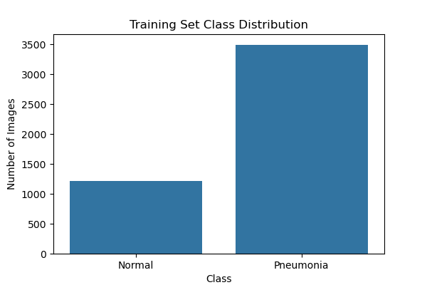
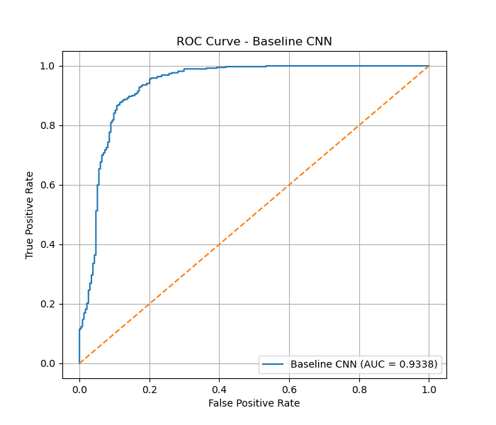
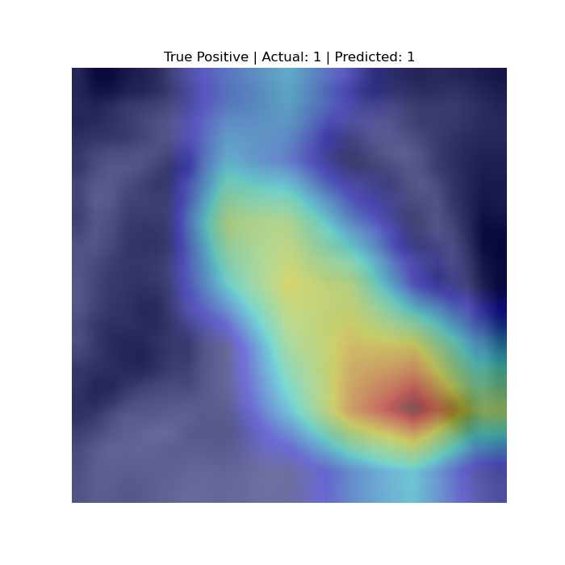
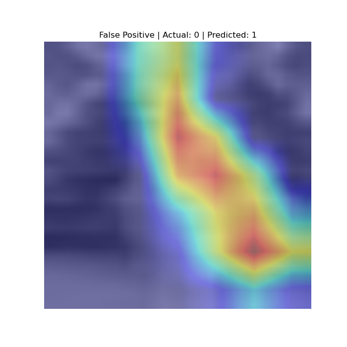

# PneumoniaMNIST Image Classification (EC-417, P19)

A weighted, pretrained ResNet-18 reaches **ROC-AUC 0.9771, sensitivity 98.97% and specificity 78.21%** on the PneumoniaMNIST test set, up from a small CNN's 0.9338 / 96.41% / 77.35%.

> **Educational project, not a clinical tool.** It must not be used for diagnosis or patient-care decisions.

## 1. Problem

Binary screening: classify a 28×28 pediatric chest X-ray as Normal (0) or Pneumonia (1).

The classes are imbalanced, so accuracy alone is not enough. We report **ROC-AUC** (ranking quality at any threshold), **sensitivity** (share of pneumonia cases found) and **specificity** (share of normal cases cleared). The decision threshold is chosen on the validation set, never on the test set.

## 2. Data

- **Source:** PneumoniaMNIST from [MedMNIST v2](https://medmnist.com/v2), derived from the Kermany et al. (2018) pediatric chest X-ray dataset. Loaded with `pip install medmnist`.
- **Size and format:** 5,856 images, 28×28 grayscale. License: CC BY 4.0 (check the MedMNIST page for current terms).
- **Split:** the official one, used unchanged: train 4,708, validation 524, test 624.
- **Class balance:**

| Split | Normal | Pneumonia | Pneumonia share |
|---|---:|---:|---:|
| Train | 1,214 | 3,494 | 74.2% |
| Test | 234 | 390 | 62.5% |

Train counts come from notebook 01; test counts from the confusion matrices. MedMNIST builds the validation set by splitting 9:1 from the source training set, while the test set is a separate source split. This matters for the results below.



## 3. Method

| Model | What it is |
|---|---|
| Baseline CNN | `Conv(1→16) → ReLU → MaxPool → Conv(16→32) → ReLU → MaxPool → Flatten → Linear(1568→64) → ReLU → Linear(64→2)` |
| ResNet-18 | Pretrained weights; final layer replaced by `Linear(512, 2)`; images resized to 224×224 and copied to 3 channels |
| + class-weighted loss | A fresh pretrained ResNet-18 trained with weighted cross-entropy. Weights = `n_samples / (2 × class_count)` = **1.939** (Normal) and **0.674** (Pneumonia) |
| + threshold 0.80 | Thresholds 0.10 to 0.90 were scanned on the validation set; 0.80 was picked from that table, where sensitivity and specificity are nearly equal (96.92% / 97.04%) |

| Model | Loss | Optimizer | LR | Batch | Epochs |
|---|---|---|---:|---:|---:|
| Baseline CNN | Cross-entropy | Adam | 0.001 | 64 | 20 |
| ResNet-18 | Cross-entropy | Adam | 0.0001 | 32 | 10 |
| Weighted ResNet-18 | Weighted cross-entropy | Adam | 0.0001 | 32 | 10 |

## 4. Results

Test set, 624 images, **one training run per model** (no seeds were fixed, so there are no error bars).

| Model | Threshold | Accuracy | Sensitivity | Specificity | ROC-AUC |
|---|---:|---:|---:|---:|---:|
| Trivial (always "pneumonia") | – | 62.50% | 100.00% | 0.00% | 0.5000 |
| Baseline CNN | 0.50 | 89.26% | 96.41% | 77.35% | 0.9338 |
| ResNet-18 | 0.50 | 84.62% | 100.00% | 58.97% | 0.9639 |
| + class-weighted loss | 0.50 | 88.30% | 99.74% | 69.23% | 0.9771 |
| **+ threshold 0.80 (final)** | **0.80** | **91.19%** | **98.97%** | **78.21%** | **0.9771** |

The trivial row is computed from the test class counts, not trained.

| Model | TN | FP | FN | TP |
|---|---:|---:|---:|---:|
| Baseline CNN | 181 | 53 | 14 | 376 |
| ResNet-18 | 138 | 96 | 0 | 390 |
| + weighted loss (0.50) | 162 | 72 | 1 | 389 |
| + threshold 0.80 | 183 | 51 | 4 | 386 |

What each change did:

- **Pretraining** raised ROC-AUC (0.9338 to 0.9639), but at 0.5 it flagged 96 normal images as pneumonia.
- **Weighted loss** cut false positives from 96 to 72 and raised specificity from 58.97% to 69.23%.
- **Threshold 0.80** cut them again to 51, at the cost of 3 more missed pneumonia cases (1 to 4).
- ROC-AUC does not depend on the threshold, so the 0.9639 to 0.9771 gain comes from the weighted training run. With one seed, run-to-run noise cannot be ruled out.



## 5. Error analysis

Grad-CAM (layer `layer4[-1].conv2`, pneumonia class) was run on the first 5 true positives and first 5 false positives at threshold 0.80 (`plots/gradcam/`).

- In **3 of the 5 false positives** (test indices 28, 30, 44) the strongest activation sits at the top edge of the image, above the lungs, not on lung tissue.
- In **4 of the 5 true positives and 2 of the 5 false positives** the peak is at the same lower-right edge location. The same hot spot on both correct and wrong predictions suggests the model uses a position or border cue, not only lung appearance.
- This is a small, hand-inspected sample, so it is a hypothesis and not a proof. Grad-CAM shows what influenced a prediction, not that the region is medically meaningful.

 

## 6. Limitations and ethics

- **Distribution gap:** at 0.5 the weighted model has 94.81% specificity on validation but 69.23% on test. Validation comes from the training source and test from a separate one, so the 0.80 threshold may not transfer.
- **Single run:** no seeds fixed, no mean ± std.
- **Threshold applied to one model:** the CNN and plain ResNet-18 were scored at 0.5 only.
- **Preprocessing:** no ImageNet mean/std normalization and no data augmentation.
- **Resolution and data:** 28×28 images hold far less detail than real X-rays; small dataset; no external validation.
- **Misuse:** a screening score like this could be mistaken for a diagnosis. It is not one.

## 7. Reproduce

```bash
pip install -r requirements.txt
mkdir -p results plots        # results/ is gitignored; notebooks save weights there
jupyter notebook              # run notebooks/01 to 04 top to bottom, in order
```

| Notebook | Purpose |
|---|---|
| `01_data_exploration` | data loading, class balance, sample images |
| `02_cnn_baseline` | baseline CNN, metrics, saves `baseline_cnn.pth` |
| `03_resnet18_transfer_learning` | ResNet-18, class weights, threshold scan, final test metrics |
| `04_gradcam` | Grad-CAM on true and false positives |

Hardware: runs on a laptop CPU (notebook 04 reported `cpu`); training time was not recorded. Datasets and `.pth` weights are not committed (`.gitignore`).

## 8. References

- Yang, J. et al. (2023). MedMNIST v2: a large-scale lightweight benchmark for 2D and 3D biomedical image classification. *Scientific Data*, 10, 41.
- Kermany, D. S. et al. (2018). Identifying medical diagnoses and treatable diseases by image-based deep learning. *Cell*, 172(5), 1122–1131.
- He, K., Zhang, X., Ren, S., Sun, J. (2016). Deep residual learning for image recognition. *CVPR*, 770–778.
- Selvaraju, R. R. et al. (2017). Grad-CAM: visual explanations from deep networks via gradient-based localization. *ICCV*, 618–626.